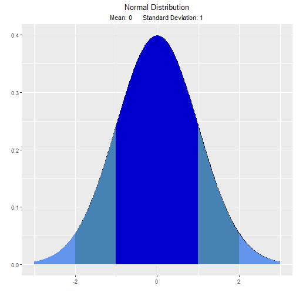
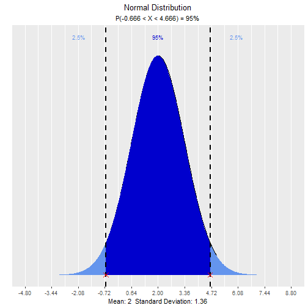
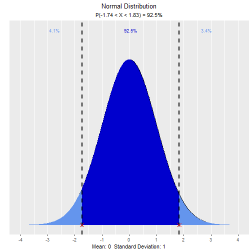

# vistributions

> Visualize probability distributions

## Installation

`# Install release version from CRAN`` `[`install.packages`](https://rdrr.io/r/utils/install.packages.html)`(``"vistributions"``)`` `` ``# Install development version from GitHub`` ``# install.packages("devtools")`` ``devtools``::`[`install_github`](https://devtools.r-lib.org/reference/install-deprecated.html)`(``"rsquaredacademy/vistributions"``)`

## Articles

- [Explore
  Distributions](https://vistributions.rsquaredacademy.com/articles/introduction-to-vistributions.html)

## Usage

### Normal Distribution

`# visualize normal distribution`` `[`vdist_normal_plot`](https://vistributions.rsquaredacademy.com/reference/vdist_normal_plot.md)`(``)`

plot of chunk normal

` ``# visualize quantiles out of given probability`` `[`vdist_normal_perc`](https://vistributions.rsquaredacademy.com/reference/vdist_normal_plot.md)`(``0.95``, mean ``=`` ``2``, sd ``=`` ``1.36``, type ``=`` ``'both'``)`

plot of chunk normal

` ``# visualize probability from a given quantile`` `[`vdist_normal_prob`](https://vistributions.rsquaredacademy.com/reference/vdist_normal_plot.md)`(`[`c`](https://rdrr.io/r/base/c.html)`(``-``1.74``, ``1.83``)``, type ``=`` ``'both'``)`

plot of chunk normal

## Getting Help

If you encounter a bug, please file a minimal reproducible example using
[reprex](https://reprex.tidyverse.org/index.html) on github. For
questions and clarifications, use
[StackOverflow](https://stackoverflow.com/).
